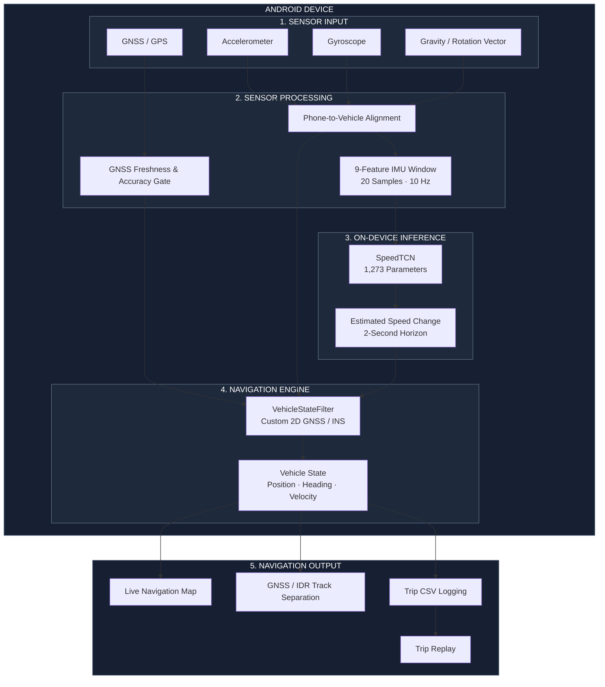

# Path Sārathi
### Intelligent Dead Reckoning for GNSS-Denied Navigation

<p align="center">
  
</p>

<p align="center">
  <strong>When GPS disappears, navigation shouldn't.</strong>
</p>

<p align="center">
  Android · GNSS + IMU Fusion · On-Device Machine Learning · Intelligent Dead Reckoning
</p>

---

## Overview

**Path Sārathi** is a smartphone-based Intelligent Dead Reckoning (IDR) system developed for the Smart India Hackathon problem statement:

*AI-ML based Intelligent Dead Reckoning System for Seamless Navigation.*

The system addresses a fundamental limitation of conventional navigation: the loss of reliable GNSS signals in tunnels, underground parking areas, dense urban environments and other signal-denied locations.

Instead of relying entirely on GPS, Path Sārathi uses the smartphone's inertial sensors to estimate vehicle movement and maintain a continuous position estimate during temporary GNSS outages.

It combines:
- GNSS measurements for absolute positioning.
- Accelerometer, gyroscope, gravity and rotation-vector data for motion estimation.
- A lightweight temporal CNN for speed-change estimation.
- A custom 2D GNSS/INS state filter for continuous navigation.
- On-device inference to avoid dependence on cloud connectivity during outages.

<blockquote>
<strong>Current build:</strong> Functional Android engineering demonstrator with an integrated ML inference pipeline. The final blackout drift target has not yet been independently validated across multiple phones and vehicles.
</blockquote>

## 01. System Architecture

The architecture follows a sensor-to-estimation-to-navigation pipeline. Raw sensor measurements are processed locally, aligned with the vehicle's direction of travel and passed to the navigation filter.



### Navigation pipeline

| Stage | Responsibility |
|---|---|
| Sensor input | Collects GNSS and smartphone IMU measurements |
| Sensor processing | Checks GNSS freshness and aligns phone sensor axes with vehicle movement |
| ML inference | Estimates short-term speed change using SpeedTCN |
| State estimation | Propagates vehicle motion and corrects position using available GNSS observations |
| Navigation output | Displays the estimated trajectory and records trip data |

### Position source indicators

The navigation interface deliberately distinguishes measured positions from estimated positions.

| Indicator | Meaning |
|---|---|
| 🔵 Blue | GNSS observation / route guidance |
| 🟡 Gold | Dead Reckoning estimated trajectory |
| 📍 Marker | Current estimated vehicle position |

An estimated IDR segment is never presented as a fresh GPS observation.

---

## 02. How Dead Reckoning Works

Path Sārathi uses a state-based approach rather than simply drawing a projected line when GPS disappears.

**Normal GNSS operation**

1. The application obtains a fresh and sufficiently accurate GNSS fix.
2. IMU measurements are continuously collected.
3. The navigation filter propagates vehicle motion using inertial measurements.
4. New GNSS observations correct the estimated state.

**During a GNSS outage**

1. The application detects stale or unavailable GNSS measurements.
2. The navigation state switches to `DEAD_RECKONING`.
3. The filter continues propagating the vehicle state using inertial measurements.
4. SpeedTCN provides a bounded speed-consistency signal.
5. The application displays the estimated trajectory separately from observed GNSS data.

**When GNSS returns**

The next accepted GNSS observation corrects the existing navigation state. The application continues the trip without deliberately resetting the trajectory.

### VehicleStateFilter

The navigation engine implements a custom lightweight 2D GNSS/INS filter.

Its current responsibilities include:

- Position and velocity propagation.
- GNSS measurement updates.
- Accelerometer and gyroscope bias adaptation.
- Uncertainty tracking.
- Non-holonomic vehicle constraint to limit independent lateral-velocity accumulation.

This is a custom engineering implementation, not a claim of a certified EKF or UKF.

---

## 03. Machine Learning: SpeedTCN

A compact temporal convolutional network is integrated into the Android application.

The model processes a rolling window of IMU-derived features and estimates short-term speed change.

| Specification | Implementation |
|---|---|
| Model | SpeedTCN |
| Architecture | Depthwise Temporal CNN |
| Input features | 9 IMU-derived features |
| Input window | 20 samples |
| Sampling frequency | 10 Hz |
| Model parameters | 1,273 |
| Output | Speed change over 2 seconds (m/s) |
| Inference | On-device |
| Model format | JSON |
| Model asset | `app/src/main/assets/speed_tcn_all_io_vnbd.json` |

The model is intentionally small enough to be packaged with the Android application.

No cloud inference is required during a GNSS outage.

**Important:** SpeedTCN is used as a bounded consistency/confidence signal within the navigation pipeline. It is not an absolute position predictor.

### Training and evaluation

The training pipeline is maintained separately under `idr-benchmark/`.

It uses the public IO-VNBD inertial and odometry dataset and includes:

- Dataset preparation and feature extraction.
- Drive/session-oriented data splitting.
- Training and model export.
- Feature and output contract checks.
- Model inference verification.

The packaged model is validated against the expected input feature order, window length and output semantics before use.

---

## 04. Implemented Features

| Feature | Implementation |
|---|---|
| Live Android navigation | ✓ |
| GNSS positioning | ✓ |
| Accelerometer and gyroscope capture | ✓ |
| Gravity and rotation-vector integration | ✓ |
| GNSS freshness and accuracy checks | ✓ |
| Simulated GNSS outage | ✓ |
| Dead Reckoning state transition | ✓ |
| Phone-to-vehicle mount calibration | ✓ |
| On-device SpeedTCN inference | ✓ |
| Custom 2D GNSS/INS filter | ✓ |
| Source-separated navigation tracks | ✓ |
| Destination search and route guidance | ✓ |
| Voice navigation prompts | ✓ |
| Trip CSV logging | ✓ |
| Saved-trip library | ✓ |
| Trip replay | ✓ |

### GNSS outage demonstration

The application includes a **Test Outage** control to demonstrate navigation when fresh GNSS measurements are unavailable.

This is a software-level simulation: the application withholds fresh GNSS updates from the fusion filter. It does not jam, interfere with or disable the device's GPS hardware.

---

## 05. Implementation Status

We distinguish between working application features, research components and capabilities that still require field validation.

| Capability | Status |
|---|---|
| Smartphone GNSS + IMU acquisition | Implemented |
| GNSS freshness detection | Implemented |
| Phone-to-vehicle alignment | Implemented |
| On-device ML inference | Implemented |
| GNSS/INS state fusion | Implemented |
| Navigation visualization | Implemented |
| Trip recording and replay | Implemented |
| Offline road-network map matching | Demo / research only |
| 200 Hz external IMU integration | Planned |
| Multi-phone and multi-vehicle validation | Pending |
| Verified blackout drift below 10% | Not yet established |

The application does not currently snap the live estimate to an unverified road network. Incorrect map matching could produce misleading position jumps, especially when using a map extract from a different geographical region.

---

## 06. Repository Structure

```text
Path_Sarthi/
│
├── app/
│   └── Android application
│       └── src/main/assets/
│           └── speed_tcn_all_io_vnbd.json
│
├── engine/
│   └── Python navigation and filter implementations
│
├── idr-benchmark/
│   └── Dataset preparation
│   └── Model training
│   └── Evaluation and inference tools
│
├── tests/
│   └── Unit and contract tests
│
├── docs/
│   └── Engineering documentation
│   └── Judge demonstration guide
│
├── logo/
│   └── logo.png
│
└── README.md
```

---

## 07. Technology Stack

| Component | Technology |
|---|---|
| Mobile application | Native Android |
| Language | Java |
| Positioning | Android GNSS APIs |
| Motion sensing | Android Sensor APIs |
| Navigation engine | Custom Java 2D filter |
| Machine learning | PyTorch / SpeedTCN |
| Model deployment | Local JSON asset |
| Benchmarking | Python, NumPy, Pandas |
| Visualization | MapLibre |
| Map data | OpenStreetMap |
| Routing | OSRM |
| Destination search | Nominatim |

---

## 08. Build and Run

### Prerequisites

- Android Studio and Android SDK.
- JDK 17 or newer.
- Physical Android device running Android 8.0 (API 26) or newer.
- GNSS, accelerometer, gyroscope, gravity and rotation-vector sensors.

Internet access is currently required for the demonstration's live map tiles, routing and destination search.

### Clone the repository

```bash
git clone https://github.com/SahinS14/Path_Sarthi.git

cd Path_Sarthi
```

### Build the application

```bash
./gradlew assembleDebug
```

The generated APK will be available at:

```text
app/build/outputs/apk/debug/app-debug.apk
```

### Install on a connected Android device

```bash
adb install -r app/build/outputs/apk/debug/app-debug.apk
```

For distribution, generate a signed release APK using Android Studio:

`Build → Generate Signed Bundle / APK`

Do not commit signing keys, passwords or release credentials.

### Run Python tests

Create an isolated Python environment and install the benchmark dependencies (`numpy`, `pandas`, `matplotlib`, and `torch`).

```bash
PYTHONPATH="engine/src:idr-benchmark/src" \
python3 -m unittest discover -s tests -p 'test_*.py'
```

### Train SpeedTCN

After downloading and preparing the IO-VNBD dataset:

```bash
PYTHONPATH=idr-benchmark/src \
python3 idr-benchmark/src/train_speed_model.py \
--dataset "/absolute/path/to/IO-VNBD/raw/Synchronised V abd S datasets/Categorised IOVNB Dataset"
```

---

## 09. Dataset and References

The machine learning pipeline uses the publicly available [IO-VNBD dataset](https://github.com/onyekpeu/IO-VNBD).

Please follow the dataset's original licence and usage conditions.

Other technologies and resources:

- [MapLibre](https://maplibre.org/) — map rendering.
- [OpenStreetMap](https://www.openstreetmap.org/copyright) — geographical data.
- [OSRM](https://project-osrm.org/) — route calculation.
- [Nominatim](https://nominatim.org/) — destination search.

The current demonstration uses public mapping and routing services. Production deployment will require an appropriately licensed provider or self-hosted infrastructure.

---

## 10. Safety and Limitations

Path Sārathi is a research and engineering demonstrator, not a certified safety-critical navigation system.

- Position estimates during GNSS outages are approximate and can accumulate drift.
- Performance depends on phone sensor quality, mounting orientation and vehicle dynamics.
- Multi-device and multi-vehicle field qualification remains necessary.
- The current application depends on online services for parts of its map and routing functionality.
- Sensor and trip logs remain in local application storage and are shared only through explicit user export.

For testing, run outage demonstrations while stationary or have a passenger operate the application. Never interact with the phone while driving.

---

## 11. Future Engineering Work

The next development priorities are:

1. Collect and evaluate real-world blackout traces across multiple Android devices and vehicles.
2. Quantify position drift against independent reference trajectories.
3. Develop and validate an offline OSM road-network package with conservative map matching.
4. Integrate and validate a 200 Hz external IMU adapter.
5. Improve filter robustness under changing vehicle dynamics.
6. Add automated build, testing and signed-release workflows.

---

## Acknowledgements

We acknowledge the IO-VNBD contributors for providing the inertial and odometry dataset, along with the MapLibre and OpenStreetMap communities for the mapping foundations used in this project.

---

<p align="center">
  <strong>Path Sārathi</strong><br>
  Intelligent navigation beyond GNSS availability.
</p>

<p align="center">
  Built as part of the Smart India Hackathon.
</p>
